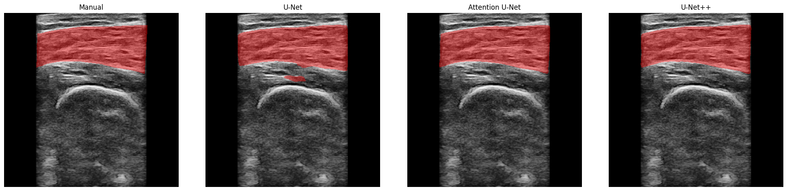

# Segmentación ecográfica del recto femoral con Deep Learning (U-Net, Attention U-Net y U-Net++)


Este repositorio contiene el código y los resultados del Trabajo Final de Máster (Máster en Ciencia de Datos, UOC, 2026) sobre la **segmentación automática del músculo recto femoral** en imágenes de ecografía de adultos mayores mediante **redes neuronales profundas**. El objetivo es generar **máscaras de segmentación** y derivar **parámetros morfométricos** (área transversal y grosor/profundidad) para apoyar el análisis de la sarcopenia.

Se han evaluado tres arquitecturas de segmentación biomédica, entrenadas desde cero (sin pesos preentrenados):

- **U-Net** (baseline)
- **Attention U-Net**
- **U-Net++**

El entrenamiento se realizó sobre un subconjunto anotado de **450 imágenes con máscara manual**. Después, los modelos se aplicaron a la cohorte completa de **4.500 imágenes multicéntricas** (9 centros clínicos) para inferencia y extracción morfométrica.

> **Nota importante (datos y privacidad):** las imágenes ecográficas provienen de un entorno clínico (estudios ECOSARC y ECOSARC-2, con aprobación de comité de ética y consentimiento informado) y **no se incluyen** en este repositorio. Se proporcionan notebooks y la estructura de carpetas para reproducir el pipeline con datos locales.

---

## Resultados principales

Métricas globales de segmentación de los tres modelos (memoria del TFM, Cuadro 5.3):

| Modelo | Dice | IoU | Sensibilidad | Especificidad | Parámetros | Épocas |
|---|---|---|---|---|---|---|
| U-Net | 0,8892 | 0,8130 | 0,8905 | 0,9868 | 7,85 M | 35 |
| Attention U-Net | **0,9006** | **0,8326** | 0,8891 | **0,9906** | 8,2 M | 60 |
| U-Net++ | 0,8990 | 0,8284 | **0,8966** | 0,9890 | 9,16 M | 52 |

- **Comparación estadística (Wilcoxon pareado):** Attention U-Net y U-Net++ superan a U-Net de forma significativa en Dice (p = 0,015 y p = 0,020) y en IoU (p = 0,012 y p = 0,023). Entre Attention U-Net y U-Net++ no hay diferencias significativas (p > 0,28).
- **Efecto del tamaño del conjunto anotado:** al pasar de 250 a 450 máscaras manuales, el Dice global de U-Net subió de 0,847 a 0,889.
- **Variabilidad entre centros:** el rendimiento varía más entre centros que entre modelos. Los mejores Dice se obtienen en Salamanca, Getafe, Goya-Madrid y Barcelona (≈0,92–0,94). El más bajo corresponde a Cáceres (≈0,82–0,83).
- **Error en el área transversal frente a las máscaras manuales:**

| Modelo | MAE (cm²) | Error relativo medio |
|---|---|---|
| U-Net | 0,325 | 7,1 % |
| Attention U-Net | 0,195 | 4,1 % |
| U-Net++ | 0,216 | 4,6 % |

- **Parámetros morfométricos en la cohorte de 4.500 imágenes:** área media entre 4,47 y 4,62 cm² y grosor medio entre 1,86 y 1,94 cm, según el modelo.

<!--
Ejemplos visuales: sube las figuras a docs/figures/ y descomenta estas líneas.


-->

---

## Contenido del repositorio

- `notebooks/`: preprocesado, entrenamiento, inferencia y análisis comparativo.
- `html/`: notebooks guardados en formato HTML, con la ejecución y los resultados obtenidos.
- `masks/`: máscaras generadas por los modelos U-Net, Attention U-Net y U-Net++.
- `results/`: tablas y métricas exportadas (CSV/JSON), sin información identificable.
- `TFM_Sáez_Larrosa_AngelJesus.pdf`: memoria completa del trabajo.
- `Presentación_Segmentación Ecográfica del Recto Femoral con Deep Learning.pdf`: presentación de la defensa.
- `requirements.txt`: dependencias para reproducibilidad.
- `CITATION.cff` y `LICENSE`: cita y licencia del código.

---

## Pipeline (visión general)

1. **Construcción y preprocesado del dataset**
   - Eliminación de anotaciones y elementos superpuestos (textos, iconos del ecógrafo, barras de escala)
   - Recorte automático centrado (umbralización y detección de píxeles no nulos)
   - Redimensionado a 384×384 px con padding y normalización de intensidad (histogramas y CLAHE)
   - Preparación de pares imagen–máscara para entrenamiento supervisado

2. **Entrenamiento** (TensorFlow/Keras, desde cero)
   - Modelos: U-Net, Attention U-Net, U-Net++
   - Pérdida: Dice Loss
   - Optimizador: Adam (lr inicial 1e-4)
   - Batch size: 8 (máximo de 60 épocas)
   - Early stopping sobre el Dice de validación
   - Data augmentation: rotaciones, escalados leves, inversión horizontal y variaciones de brillo
   - Partición del conjunto anotado: 70 % entrenamiento, 12 % validación y 18 % test

3. **Evaluación**
   - Métricas principales: **Dice** e **IoU** (además de sensibilidad y especificidad)
   - Evaluación global y por centro
   - Comparación estadística (Wilcoxon pareado) entre arquitecturas
   - Error en el área transversal frente a las máscaras manuales

4. **Inferencia sobre la cohorte completa (4.500 imágenes)**
   - Generación automática de máscaras
   - Cálculo de parámetros morfométricos:
     - Área transversal (cm²)
     - Grosor / profundidad (cm)

---

## Limitaciones

- **Medidas automáticas sin revisión manual:** las medidas de la cohorte de 4.500 imágenes se obtuvieron de forma automática, sin revisión caso a caso. Se observaron casos puntuales con valores atípicos (p. ej., mínimos de 0), atribuibles a fallos de segmentación o baja calidad de imagen. Se recomienda limpieza y control de calidad adicionales antes de cualquier uso clínico.
- **Partición por imagen, no por sujeto:** las imágenes se recibieron anonimizadas y sin identificador de sujeto. Si hubiera varias imágenes de un mismo individuo repartidas entre subconjuntos, el rendimiento podría estar sobreestimado.
- **Entrenamiento desde cero:** no se usó aprendizaje por transferencia. Queda como línea futura, junto con nnU-Net y modelos basados en transformers.
- **Uso exclusivamente investigador:** este software no es un producto sanitario y no debe usarse para decisiones clínicas.

---

## Estructura esperada de datos (local)

Crea una carpeta `data/` (ignorada por git) con una estructura similar a esta:

```text
data/
├─ processed/
│  ├─ <CENTRO_1>.jpeg
│  └─ <CENTRO_2>.jpeg
├─ masks_manual/
│  ├─ <CENTRO_1>.png
│  └─ <CENTRO_2>.png
└─ pred_masks/
   ├─ UNet/
   │  └─ <CENTRO_1>.png
   ├─ AttentionUNet/
   │  └─ <CENTRO_1>.png
   └─ UNetPlusPlus/
      └─ <CENTRO_1>.png
```

> Ajusta las rutas según tu entorno. En los notebooks hay celdas para configurar las rutas base.

---

## Instalación

Se recomienda usar un entorno virtual con Python 3.10 (versión usada en el trabajo). Para entrenar con GPU se necesita un entorno compatible con CUDA. El trabajo se desarrolló con una NVIDIA RTX 5070 de 12 GB.

```bash
git clone https://github.com/angel20uoc/automatic_segmentation_femoral_rectus.git
cd automatic_segmentation_femoral_rectus

python -m venv .venv

# Windows
.venv\Scripts\activate

# Linux / macOS
source .venv/bin/activate

pip install -r requirements.txt
```

---

## Ejecución (orden recomendado)

1. Preprocesado del dataset
2. Entrenamiento de los modelos (U-Net, Attention U-Net, U-Net++)
3. Inferencia sobre la cohorte completa
4. Análisis comparativo de resultados

Los notebooks correspondientes están en `notebooks/`.

---

## Autor y licencia

**Ángel Jesús Sáez Larrosa**
Máster en Ciencia de Datos (UOC). Director del TFM: Sergi Martínez Maldonado.

- LinkedIn: [angel-jesus-saez-larrosa](https://www.linkedin.com/in/angel-jesus-saez-larrosa)
- ORCID: [0009-0006-7175-5058](https://orcid.org/0009-0006-7175-5058)

El código se distribuye bajo licencia **MIT** (ver `LICENSE`). La memoria del TFM se distribuye bajo licencia **Creative Commons Reconocimiento-NoComercial 3.0 España (CC BY-NC 3.0 ES)**. Si utilizas este trabajo, puedes citarlo con `CITATION.cff`.


